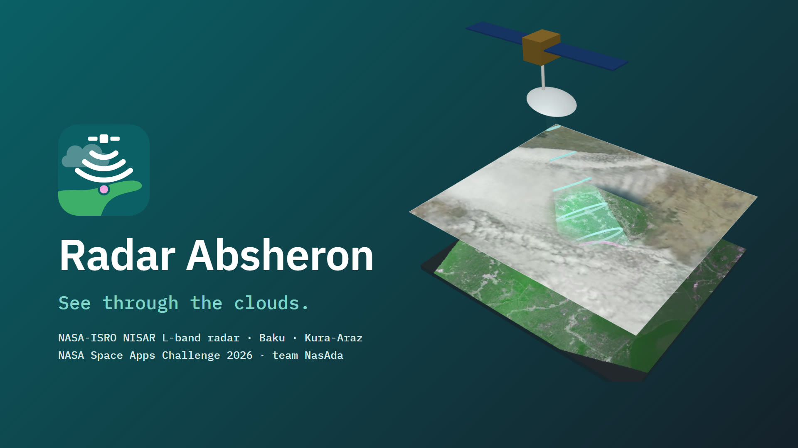

# Radar Absheron



**Watch the 30-second video:** [promo.mp4](pitch/intro/promo.mp4) (https://suathamzali.github.io/radar-absheron/pitch/intro/promo.mp4) · **Live app:** https://suathamzali.github.io/radar-absheron/


**Can a satellite watch Azerbaijan's land change, through clouds and in the dark?** Radar Absheron is an interactive web story map that plays calibrated NASA-ISRO **NISAR** L-band radar over Baku, the Absheron peninsula and the Kura-Araz lowland, and explains in plain language (English and Azerbaijani) what changed, why, and what the data cannot tell you. It works with a keyboard and is built for screen readers (not yet tested with one).

Built for the **NASA Space Apps Challenge 2026**, challenge *"Dancing with the SARs"*, by team **NasAda** (Baku, Azerbaijan).

> **Live demo:** https://suathamzali.github.io/radar-absheron/ · **Code:** https://github.com/suathamzali/radar-absheron · **Pitch (7 slides):** https://suathamzali.github.io/radar-absheron/pitch/ ([PDF EN](pitch/radar-absheron-pitch-en.pdf), [PDF AZ](pitch/radar-absheron-pitch-az.pdf))

## The problem
Radar images are powerful (day or night, through cloud) but hard to read: grey speckle, strange colours, units like σ⁰ in decibels. People who could use them, such as farmers, water managers, teachers and students in Azerbaijan, rarely do.

## Our solution
| View | NASA data | What you see |
|---|---|---|
| Radar sees through clouds | MODIS true colour + NISAR, both 12 Jul 2026 | Swipe: clouds over the Kura lowland vs the clear radar view of the same morning |
| How to read radar colours | NISAR SME2 σ⁰ HH/HV | Legend first: magenta = HH (buildings, rough ground), green = HV (plant volume), dark = smooth water |
| The dance | 10 NISAR passes, 18 Jun–16 Oct 2026 | Time-lapse that plays once: the sea flickers, the land flashes on 4 Oct, Baku changes least |
| The radar felt the rain | NISAR soil moisture + NASA POWER rain | Swipe 22 Sep vs 4 Oct: the first autumn rain (3 Oct) |
| Kura-Araz lowland | NISAR HV, MODIS NDVI | An honest negative result: at 200 m–1 km the farmland barely changed |
| Absheron | NISAR composite | A stable city and century-old oil fields: why InSAR could watch them |
| The Caspian | NISAR HH/HV + noise floor | Sea brightness follows the wind; HV over the sea is instrument noise |
| Find the change | NISAR HH dB difference | Change map: 69 % of land cells brightened by > 1.5 dB after the rain |
| Explore | all of the above | Any layer, any date (15 passes Nov 2025–Oct 2026: 10 provisional, 5 beta), swipe with optical/NDVI, click anywhere for a calibrated time series |

### How it works for the user
Every step opens with an **"In short"** box in everyday language (no jargon); the science, numbers and sources sit under **"More detail"**. Hard words (radar, HH, HV, dB, σ⁰, m³/m³, noise floor, NDVI, InSAR…) are underlined: tap one for a one-sentence explanation. A start screen asks one question and lists three steps. The story shows the legend before the data, plays the time-lapse once and then explains, and ends with a summary card ("what you saw, why it matters, what NISAR could do next"). Every view has a source line and a limits box. Explore mode hands over all controls.

### Findings (all checkable in the app)
- After **3 October 2026** rain (NASA POWER: ~18 mm around Baku, ~12 mm in the Kura-Araz lowland), the median land HH σ⁰ in the frame rose from **−13.5 to −11.3 dB** and median soil moisture from **0.18 to 0.23 m³/m³** (4 Oct pass). Part of this was scene-wide (central Baku +1.0 dB, oil fields +1.1 dB, sea +1.7 dB); the land rose **0.6–1.3 dB more than these controls** (each a single ~1 km spot, so an estimate). By 16 Oct soil moisture was back at 0.18; HH recovered only partly (−12.7 dB).
- **Human driver (irrigation), tested** (`tools/irrigation_test.py`): MODIS NDVI marks about 6,600 km² of the lowland still green in July–August (irrigated). Its NISAR soil moisture was higher than the dry steppe on all 15 dates (median +0.07 m³/m³ in summer, +0.085 in autumn), **but almost as much in winter (+0.06)**, when nobody irrigates. So the human footprint is visible, but at this resolution irrigation water cannot yet be separated from soils and groundwater.
- Over dry land HV is weak: on 63–70 % of land cells it lies within 3 dB of the noise floor.
- Over the Caspian, HV (median ≈ −20 dB) equals NISAR's noise-equivalent σ⁰ (≈ −20 dB): sea HV is noise. Sea HH varies between −16.8 and −15.1 dB and **follows the wind**: against NASA POWER hourly wind at the pass time, r = 0.63 over 15 passes (permutation p ≈ 0.01); r = 0.67 after removing the noise-floor drift; r = 0.56 without the stormy 4 Oct. The effect is modest, about +0.12 dB per m/s (`tools/wind_test.py`).
- In the Kura-Araz lowland, HV changed by a median of only +0.6 dB from June to October; fewer than 3 % of 1 km cells changed by more than 1.5 dB. Field-scale crop monitoring needs the 10–20 m GCOV product.

## Who uses it, and how it scales
| User | What they get |
|---|---|
| Farmers, agronomists | How wet their area is after rain or irrigation, free, even under clouds |
| Water and irrigation managers | Every 12 days: where water reached the land |
| Insurers, agricultural lenders | Independent evidence of rain, floods and field activity |
| Cities, planners | A stable radar record for future ground-motion (InSAR) checks |
| Schools, universities | Radar explained in Azerbaijani with real local data |

**Cost:** NASA data are free and open; the app is a static site on free hosting; one radar frame for one season is about 1 GB of download, processed on a laptop.
**Scale (plan):** the scripts work for any NISAR frame. (1) Automatic refresh after each 12-day pass; (2) all of Azerbaijan, then irrigated river basins in the South Caucasus and Central Asia; (3) field-level maps from 10–20 m GCOV, piloted with a farming cooperative or university. The tool stays free and open; tailored reports for agencies and insurers could fund it.

## Accessibility
Built in from the start: a plain-language summary on every step and a tap-to-explain glossary, keyboard control of everything (shortcuts: `[` `]` date, `P` play, `C` compare, `I` inspect map centre, `F` full-screen map (side panel hidden; also the button on the time bar), `B` `N` story, `H` or `?` help; physical key codes, so they work on an Azerbaijani layout), visible focus, native modal `<dialog>`, `aria-live` descriptions of every layer and point, a table alternative for every chart, line style + colour in charts, colour-blind-safe brown/teal change palette, reduced-motion support (no auto-play), 44 px touch targets on phones, English and Azerbaijani.

**What we tested ourselves:** in Chromium (desktop pane and 375 px phone emulation): every story step, Explore controls, swipe by mouse and keyboard, map click and `I` inspect, real key presses for `N`, `H`, `I`, arrows and `Esc`, focus moves to the step title, no unnamed controls, heading order, no horizontal overflow at 375 px, no console errors, Azerbaijani labels and dates.
**Not yet verified:** a full screen-reader session (NVDA/VoiceOver/TalkBack), real iOS and Android phones, Firefox and Safari, an automated contrast audit (colours were chosen for ≥ 4.5:1 and spot-checked only).

## Methodology and related approaches
| Approach | Strength | Gap |
|---|---|---|
| A. Expert SAR software and portals (ESA SNAP, QGIS, ASF Vertex) | Full control of raw radar data | Experts only; hours of processing |
| B. Optical maps (MODIS, NDVI viewers) | Easy to read | Blind under clouds and at night |
| C. NASA NISAR StoryMaps | Clear explanations | Fixed stories about other places, in English |
| **D. Radar Absheron (ours)** | Calibrated NISAR on one fixed dB scale, plain language in Azerbaijani and English, every claim tested against an independent source, live prototype | Still to do: field records, field-level (10–20 m) data, real-device and screen-reader tests |

How we test claims: rain vs soil moisture (NASA POWER), sea brightness vs hourly wind (`tools/wind_test.py`), clouds vs radar on the same morning (MODIS), land vs stable controls (city, oil fields, sea), irrigated vs dry land with a winter control (`tools/irrigation_test.py`). Physical basis: L-band backscatter rises with soil moisture (dielectric constant) and with sea-surface roughness from wind; HV tracks vegetation volume; calm water and smooth soil reflect the wave away.

**Impact with minimal resources:** one laptop and free NASA data cover about 6,600 km² of irrigated land plus Baku and the Caspian every 12 days, in Azerbaijani, free for everyone.

## How it works
```
ASF DAAC: NISAR L3 SME2 HDF5 (track 56, frame 22; 15 dates)   NASA POWER API   NASA GIBS WMS (MODIS)
        │ tools/fetch_nisar_sme2.py (your own Earthdata token)
        ▼
tools/build_sme2_assets.py  (h5py, numpy, Pillow)
  · nearest-neighbour resample to a Web-Mercator grid (~250 m), box 47.55–50.45° E, 39.10–41.15° N
  · σ⁰ → dB; ONE fixed stretch for every date (HH −20…−3 dB, HV −24…−9 dB); R = HH, G = HV, B = HH
  · soil moisture colour map 0–0.45 m³/m³ (non-recommended retrievals pale)
  · ~1 km data cube (HH dB, HV dB, soil moisture) + water mask
        ▼
Browser (vanilla ES modules + Leaflet 1.9.4): story, swipe, time-lapse, change map, point charts
```
**Stack:** HTML, CSS, JavaScript ES modules, [Leaflet](https://leafletjs.com) 1.9.4 from cdnjs, no build step; Python 3 for data preparation; GitHub Pages.

| Path | What |
|---|---|
| `index.html`, `css/style.css` | Page and styles |
| `js/main.js` | Controller: story, explore, time bar, inspector, keyboard, language |
| `js/map.js` | Leaflet map, layers, swipe, change map |
| `js/data.js` | Loads assets, point queries, rain between passes |
| `js/chart.js` | Accessible SVG charts + table alternative |
| `js/story.js`, `js/i18n.js`, `js/datapanel.js` | Story text, UI strings (EN/AZ), Data & method panel |
| `tools/` | Data download and preparation scripts, place list |
| `assets/data/` | Web-ready data (≈ 9 MB) |

### Run locally
```bash
python -m http.server 8765
```
Then open http://localhost:8765. To rebuild the data: `python tools/fetch_nisar_sme2.py` (asks for your Earthdata token) then `python tools/build_sme2_assets.py`.

## Data & credits
- **NISAR L3 Soil Moisture (SME2), PROVISIONAL V1**, NASA-ISRO, ASF DAAC, [doi:10.5067/NIL3SME2-P1](https://doi.org/10.5067/NIL3SME2-P1): 10 dates, 18 Jun–16 Oct 2026. Layers `sigma0HH`, `sigma0HV`, `noiseEquivalentBackscatterHV`, `soilMoisture`, `retrievalQualityFlag`, `waterbodyFraction`.
- **NISAR L3 SME2, BETA V1**, [doi:10.5067/NIL3SME2-B1](https://doi.org/10.5067/NIL3SME2-B1): 5 dates, 26 Nov 2025–13 Jan 2026 (may carry a ~1 dB offset).
- **NISAR L2 GCOV** browse images (QA colour rule) were used to design the composite: [ASF Vertex](https://search.asf.alaska.edu/#/?dataset=NISAR); [NISAR Data User Guide](https://nisar-docs.asf.alaska.edu/).
- **NASA POWER** daily precipitation, 1 Nov 2025–31 Oct 2026, two points: [power.larc.nasa.gov](https://power.larc.nasa.gov/).
- **NASA Terra/MODIS** Corrected Reflectance True Colour and NDVI 8-day, 12 Jul and 16 Oct 2026, base map NASA Blue Marble: [NASA GIBS](https://www.earthdata.nasa.gov/data/tools/gibs).
- Media are downscaled copies for web delivery.
- Software: Leaflet 1.9.4 (BSD-2-Clause); IBM Plex Sans/Mono (SIL OFL) via Google Fonts.

## Limits
PROVISIONAL/BETA products are not fully validated. Soil moisture accuracy goal is 0.06 m³/m³ (not yet validated). POWER rain is a ~50 km reanalysis estimate. Points and change maps use ~1 km cells. Explanations of farmland behaviour are hypotheses. No InSAR ground-motion analysis was done.

## Use of AI (Super Intelligence)
The team chose the challenge, the study area (our home region) and the concept, decided what to show, and checked the texts against local knowledge. An AI coding assistant (Anthropic Claude) helped write the code, the data-processing scripts and draft texts, and searched the NISAR documentation. All data shown are real NASA / NASA-ISRO measurements or models, labelled as such; no image or data value was generated by AI. The logo, the 3D illustrations, the promo video and its music were made with code written with the assistant (SVG, three.js, Remotion and a Python synthesizer, `pitch/intro/music.py`); they use only the real NASA images and tested numbers, and no generative image, video or audio model.

## Team
NasAda, Baku, Azerbaijan: Ayan Alieva, Natig Mammadov, Türkan Süleymanova, Ali Hashimzada, Suat Hamzali.

## Brand and pitch media
- Logo: `assets/brand/logo-mark.svg` (NISAR waves through a cloud to the Absheron peninsula; pink dot = the echo). Colours and type: IBM Plex Sans/Mono, teal #0B5F66, ink #15212B.
- 3D illustrations (`pitch/img/3d-hero.png`, `pitch/img/3d-stack.png`) are drawn with three.js from the app's real NASA images: `pitch/3d/scene.html`.
- 6-second intro video (`pitch/intro/intro.mp4`) made with Remotion: `pitch/intro/`.
- 30-second vertical promo (`pitch/intro/promo.mp4`, 1080x1920, with music) made with Remotion: `pitch/intro/src/Promo.tsx`. The music is synthesized from scratch by `pitch/intro/music.py` (no samples, no third-party music); scene cuts fall on its 120 BPM beat. Rebuild: `cd pitch/intro && npm install && npm run promo`, then `python music.py` and mux with ffmpeg. Its numbers are the tested results above; the app card shows the app's real output for the Kura fields point.
- Image credits: NISAR L3 SME2 (NASA/JPL, doi:10.5067/NIL3SME2-P1); MODIS Terra true colour via NASA GIBS (https://gibs.earthdata.nasa.gov). The satellite in the 3D picture is a simplified model, not to scale.
